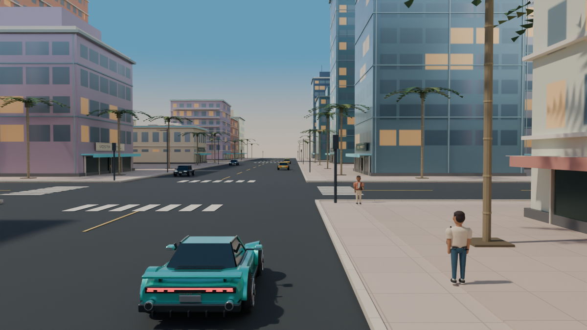
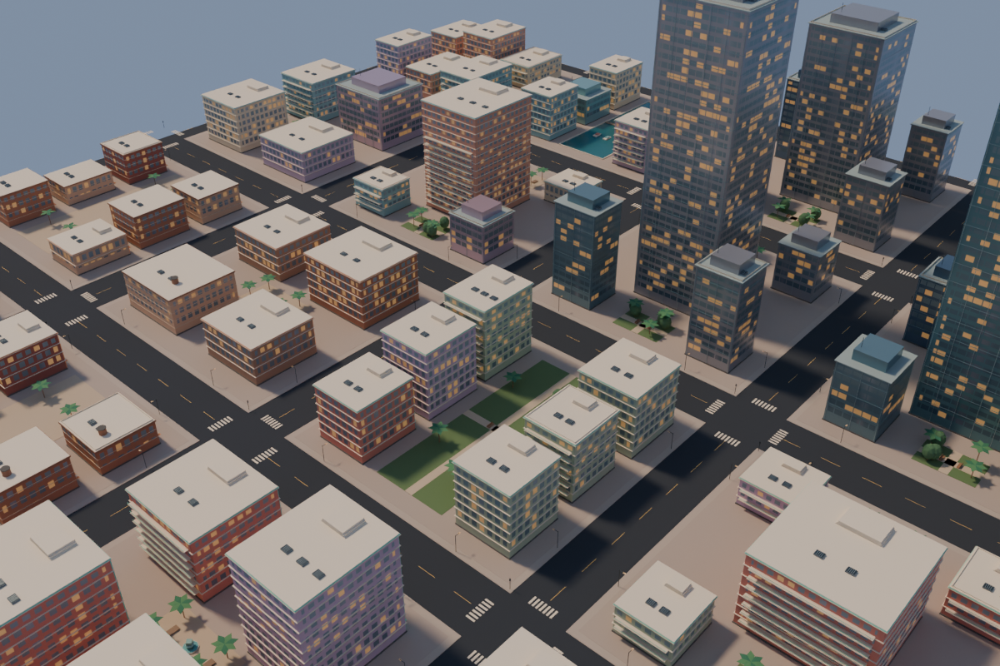
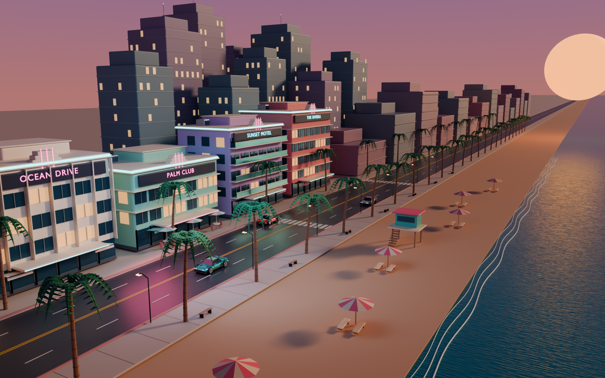
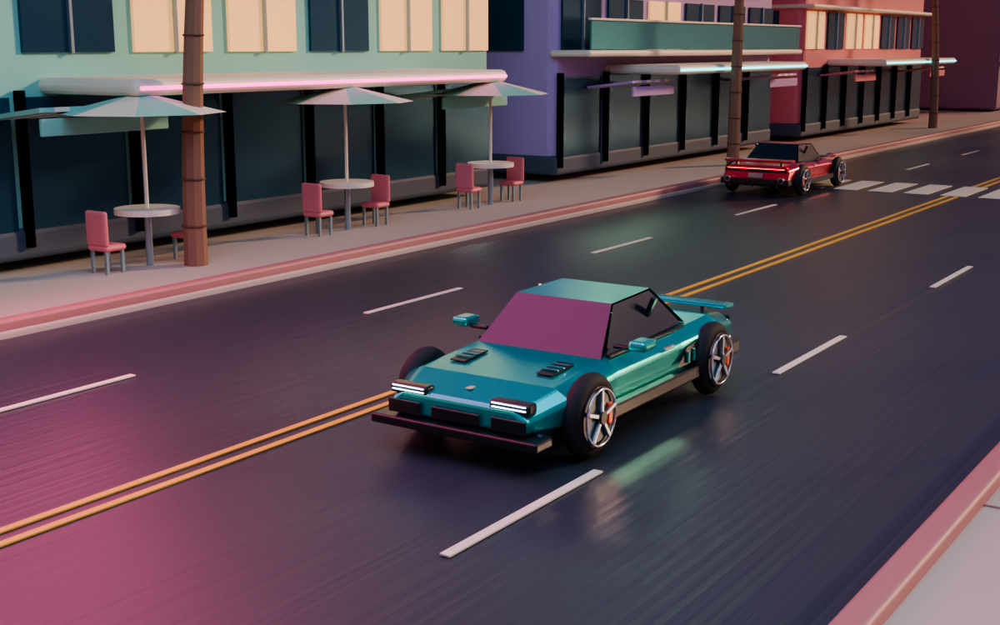

# Sunset Coast · GTA6 风格 Blender 场景

原创海滨城市与跑车镜头演示：Art Deco 建筑、热带街景与夕阳、棕榈大道、霓虹灯、沙滩和海水。包含可编辑的 Blender 工程、程序化建模脚本，以及 10 秒车辆与摄影机动画。

这是受 GTA6 海滨都市氛围启发的场景原型，不是完整游戏，也不包含 Rockstar 的模型、纹理或游戏代码。

## 在线城市体验

[打开 Sunset Coast](https://sunset-coast-drive-linyang.yanglinchasel.chatgpt.site)（公开访问）。

网页版已升级为横屏开放城市：**人物步行开局、任意车辆上下车、连续委托和现金奖励**。WASD 移动 / 驾驶，Shift 奔跑，E 交谈 / 上下车，C 切镜头，拖动自由环视。手机横屏左侧摇杆、右侧动作键。保留按需生成的无限街区和原创双曲目电台。网页版源码及完整说明在 [`web/`](web/README.md)。

本轮先查看 [Rockstar 官方 GTA VI 截图](https://www.rockstargames.com/VI/media/screenshots) 与 [Trailer 2 酒店街景](https://www.gtaboom.com/rockstar-confirms-using-in-game-ps5-footage-for-gta-6-trailer-2-e749)，以奶油白 Art Deco、珊瑚色雨棚、密集棕榈树、深色路面和冷暖日光为美术方向。参考图片不随仓库分发，网页使用原创几何、材质和店招。
最新人物街景的可编辑快照是 [`scenes/street_life.blend`](scenes/street_life.blend)，包含同一套网页城市、人物、联络人和车辆。预览采用离线 Blender 光照，实际网页为实时渲染。



```bash
node scripts/export_infinite_preview.mjs --street --seed 610 --output /tmp/street-life.json
blender -b --python-exit-code 1 --python scripts/render_infinite_preview.py -- --input /tmp/street-life.json --output previews/street_life.png --blend scenes/street_life.blend --resolution 1200
```

V2 模型增加轮拱、车身接缝、轮胎和制动细节，以及沿线建筑立面。补充建模脚本 `scripts/detail_scene.py` 可在基础工程上运行。

网页无限城市通过 `web/dist/world-layout.js` 与 `infinite-city.js` 在运行时生成，原始 `sunset_coast.blend` 保留固定海岸场景；不会把无限地图存成一个无限大的 Blender 文件。

可编辑的邻近街区快照保存在 `scenes/endless_city_preview.blend`；预览图由同一批网页实例几何生成，窗户在离线渲染时烘焙近似材质。重新生成快照：

```bash
node scripts/export_infinite_preview.mjs --seed 610 --output /tmp/endless-city.json
blender -b --python-exit-code 1 --python scripts/render_infinite_preview.py -- --input /tmp/endless-city.json --output previews/endless_city.png --blend scenes/endless_city_preview.blend
```



重新导出网页模型：

```bash
blender -b scenes/sunset_coast.blend --python-exit-code 1 --python scripts/export_web.py -- --output-dir web/dist/assets
```





[海岸航拍](previews/coast_aerial.png) · [10 秒巡游视频](previews/sunset_cruise.mp4)

## 打开工程

使用 **Blender 4.3 或更新版本**打开 [`scenes/sunset_coast.blend`](scenes/sunset_coast.blend)。

- `小键盘 0`：进入主摄影机视图。没有小键盘时，使用「视图 → 摄影机 → 活动摄影机」。
- `空格`：播放时间轴；范围为第 1–240 帧，24 fps。
- `F12`：用 Cycles 渲染当前帧。
- 工程含主跟拍、跑车特写、海岸航拍三台摄影机；在大纲视图中选中摄影机，再按 `Ctrl + 小键盘 0` 切换。

打开工程不需要安装插件或执行脚本。模型、材质、灯光和关键帧都可以直接编辑。

## 从脚本重建

在仓库根目录执行，确保 `blender` 已加入系统 PATH：

```bash
# 生成工程，并渲染主预览图（默认 1600 × 1000，48 samples）
blender -b --python-exit-code 1 --python scripts/build_scene.py -- --render

# 快速预览
blender -b --python-exit-code 1 --python scripts/build_scene.py -- --render --resolution 800 --samples 16

# 仅生成工程
blender -b --python-exit-code 1 --python scripts/build_scene.py

# 在基础工程上加入 V2 细节（可重复运行）
blender -b scenes/sunset_coast.blend --python-exit-code 1 --python scripts/detail_scene.py

# 检查保存的场景；结果写入 previews/validation.json
blender -b scenes/sunset_coast.blend --python-exit-code 1 --python scripts/validate_scene.py

# 渲染跑车特写与海岸航拍
blender -b scenes/sunset_coast.blend --python-exit-code 1 --python scripts/render_previews.py

# 输出轻量动画预览，需安装 FFmpeg（640 × 400，8 fps，10 秒）
blender -b scenes/sunset_coast.blend --python-exit-code 1 --python scripts/render_previews.py -- --mode animation --resolution 640 --samples 16
```

`--resolution` 设置宽度，高度为宽度的 62.5%；`--samples` 设置 Cycles 采样数。构建脚本仅在当前 Blender 支持 OpenImageDenoise 时自动启用降噪。`--output 路径.blend` 可指定工程输出位置。重新运行生成脚本会替换输出工程和同名预览，请先另存手动修改的版本。

动画预览可直接在 Blender 时间轴中播放。导出视频时，建议在「输出属性」设置输出目录与 FFmpeg 视频格式，再使用「渲染 → 渲染动画」。CPU 渲染整段动画耗时较长，可先降低分辨率和采样数。

## 文件

| 路径 | 内容 |
| --- | --- |
| `scenes/street_life.blend` | 人物、可驾驶车辆与街头场景的可编辑快照 |
| `previews/street_life.png` | 横版人物街景预览 |
| `scenes/endless_city_preview.blend` | 无限城市的有限邻域快照，可编辑 |
| `previews/endless_city.png` | 程序化城市离线预览 |
| `scenes/sunset_coast.blend` | 可编辑场景、材质、三台摄影机和关键帧 |
| `previews/sunset_coast.png` | 主摄影机渲染预览 |
| `previews/hero_car.png`、`previews/coast_aerial.png` | 跑车特写与海岸航拍 |
| `previews/sunset_cruise.mp4` | 8 fps 轻量视频预览；工程本身为 24 fps |
| `previews/validation.json` | 几何、资源、摄影机与动画检查结果 |
| `scripts/build_scene.py` | 组装道路、海岸、植被、灯光和动画 |
| `scripts/city.py` | Art Deco 街区与远景建筑 |
| `scripts/vehicle.py` | 原创跑车模型 |
| `scripts/detail_scene.py` | V2 轮拱、内饰、车身接缝及沿线店铺细化 |
| `scripts/validate_scene.py` | 可重复运行的工程检查 |
| `scripts/render_previews.py` | 渲染辅助视角与巡游视频 |

所有几何和材质由本项目脚本生成，不依赖外部付费素材。代码及原创资产使用 [MIT License](LICENSE)。GTA / Grand Theft Auto 商标属于各自权利人；本项目为独立非官方作品。

**English:** An original GTA6-inspired coastal environment for Blender 4.3+, with editable procedural assets and a 240-frame sunset cruise. Open the `.blend`, or rebuild it with the command above. Includes a public browser driving prototype; this is an independent project, not an official Rockstar product.
